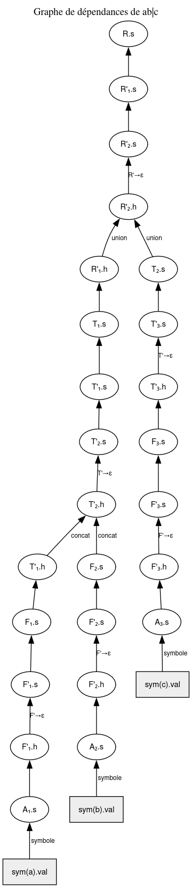
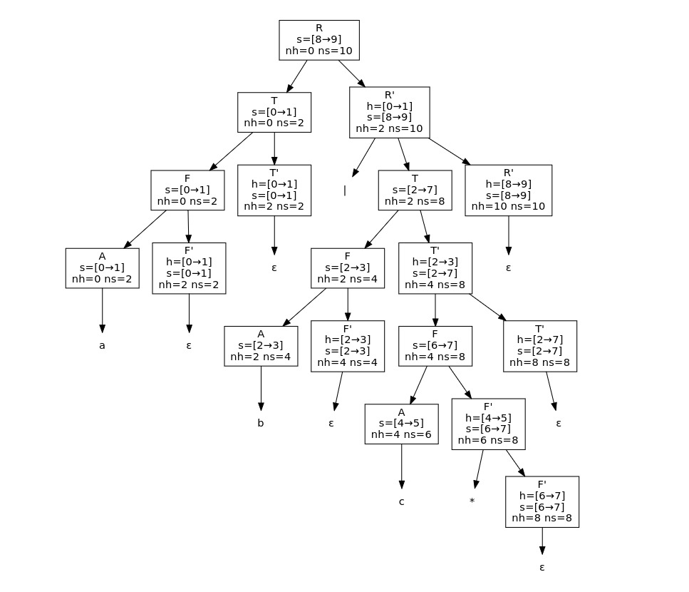

# Partie 3 — Schéma de traduction (Étudiant 2)

Ce texte est la partie écrite de l'Étudiant 2. Le code est dans `automate.py`
(fragments de Thompson) et dans `analyseurSyntaxique.py` (les actions des
méthodes `R`, `Rp`, `T`, `Tp`, `F`, `Fp`, `A`).

La Partie 3 est traitée d'abord, sans la numérotation des états. La Partie 4
ajoute ensuite l'attribut qui remplace le compteur global.

# Partie 3 — Schéma de traduction prédictif

## 1. Schéma de traduction complet

### 1.1. Forme théorique (sans numérotation)

Voici le schéma écrit comme au cours, avec seulement les fragments.

- `𝑋.ℎ` : le fragment déjà construit à gauche (attribut hérité).
- `𝑋.𝑠` : le fragment obtenu (attribut synthétisé).

Les actions entre `{}` se font à cet endroit de la règle. L'indice 1 sert à
distinguer la deuxième occurrence du même non-terminal.

```text
𝑅 → 𝑇 {𝑅′.ℎ ∶= 𝑇.𝑠} 𝑅′ {𝑅.𝑠 ∶= 𝑅′.𝑠}

𝑅′ → '|' 𝑇 {𝑅′₁.ℎ ∶= union(𝑅′.ℎ, 𝑇.𝑠)} 𝑅′₁ {𝑅′.𝑠 ∶= 𝑅′₁.𝑠}
𝑅′ → ε {𝑅′.𝑠 ∶= 𝑅′.ℎ}

𝑇 → 𝐹 {𝑇′.ℎ ∶= 𝐹.𝑠} 𝑇′ {𝑇.𝑠 ∶= 𝑇′.𝑠}

𝑇′ → 𝐹 {𝑇′₁.ℎ ∶= concat(𝑇′.ℎ, 𝐹.𝑠)} 𝑇′₁ {𝑇′.𝑠 ∶= 𝑇′₁.𝑠}
𝑇′ → ε {𝑇′.𝑠 ∶= 𝑇′.ℎ}

𝐹 → 𝐴 {𝐹′.ℎ ∶= 𝐴.𝑠} 𝐹′ {𝐹.𝑠 ∶= 𝐹′.𝑠}

𝐹′ → '*' {𝐹′₁.ℎ ∶= etoile(𝐹′.ℎ)} 𝐹′₁ {𝐹′.𝑠 ∶= 𝐹′₁.𝑠}
𝐹′ → '+' {𝐹′₁.ℎ ∶= plus(𝐹′.ℎ)} 𝐹′₁ {𝐹′.𝑠 ∶= 𝐹′₁.𝑠}
𝐹′ → '?' {𝐹′₁.ℎ ∶= option(𝐹′.ℎ)} 𝐹′₁ {𝐹′.𝑠 ∶= 𝐹′₁.𝑠}
𝐹′ → ε {𝐹′.𝑠 ∶= 𝐹′.ℎ}

𝐴 → '(' 𝑅 ')' {𝐴.𝑠 ∶= 𝑅.𝑠}
𝐴 → SYMBOLE {𝐴.𝑠 ∶= symbole(sym.val)}
𝐴 → '@' {𝐴.𝑠 ∶= vide()}
```

`union`, `concat`, `etoile`, `plus`, `option`, `symbole` et `vide` sont les
constructeurs de Thompson. `plus` et `option` ajoutent une seule arête ε et
aucun état. Le fragment `ℎ` est transmis de frère en frère : c'est ce qui
garde l'associativité à gauche.

### 1.2. Forme pratique (actions sur les fragments)

Voici la même chose en Python, en ne montrant que les fragments. La
numérotation est ajoutée en Partie 4.

| Production | Ce que fait la méthode |
| --- | --- |
| `R -> T Rp` | `f = T()` ; retourner `Rp(f)` |
| `Rp -> '|' T Rp` | lire `\|` ; `f = T()` ; `acc = make_union(h, f)` ; retourner `Rp(acc)` |
| `Rp -> ε` | retourner `h` |
| `T -> F Tp` | `f = F()` ; retourner `Tp(f)` |
| `Tp -> F Tp` | `f = F()` ; `acc = make_concat(h, f)` ; retourner `Tp(acc)` |
| `Tp -> ε` | retourner `h` |
| `F -> A Fp` | `f = A()` ; retourner `Fp(f)` |
| `Fp -> '*' Fp` | lire `*` ; `acc = make_star(h)` ; retourner `Fp(acc)` |
| `Fp -> '+' Fp` | lire `+` ; `acc = make_plus(h)` ; retourner `Fp(acc)` |
| `Fp -> '?' Fp` | lire `?` ; `acc = make_optional(h)` ; retourner `Fp(acc)` |
| `Fp -> ε` | retourner `h` |
| `A -> '(' R ')'` | lire `(` ; `f = R()` ; lire `)` ; retourner `f` |
| `A -> SYMBOLE` | retourner `make_symbol(valeur_du_jeton)` |
| `A -> '@'` | retourner `make_epsilon()` |

Un fragment est `(init, fin, transitions)`. Une transition est
`(source, étiquette, cible)` ; `None` veut dire ε.

## 2. Graphe de dépendances de `ab|c`



Ici, `h` de `Rp` prend le fragment construit par `T`, son frère gauche.
L'information va de gauche à droite. Un attribut hérité ne peut venir que du
père ou d'un frère de gauche : le schéma est **L-attribué**. Il n'est pas
**S-attribué**, car `Rp`, `Tp` et `Fp` ont un attribut `h` qu'ils reçoivent.
L'évaluation se fait pendant la descente récursive, en une seule passe.

## 3. Arbre syntaxique annoté de `a|bc*`



## 4. Pourquoi l'associativité à gauche est gardée

Les règles `Rp -> '|' T Rp` et `Tp -> F Tp` sont récursives à droite :
l'arbre de `a|b|c` penche à droite. Pourtant, `h` garde l'associativité à
gauche.

Pour `a|b|c`, `T` construit le fragment de `a` et le donne à `Rp`. `Rp` lit
`|`, construit `b`, fait `union(a, b) = (a|b)`, puis donne ce résultat au `Rp`
suivant. Celui-ci construit `c` et obtient `((a|b)|c)`. On a bien `(a|b)|c` et
non `a|(b|c)`. C'est la même chose pour la concaténation.

## 5. L'opérateur le plus délicat

`+` est le plus délicat (et `?` aussi). Le sujet écrit `r+ = r r*`. Si on
copiait `r`, les mêmes états serviraient deux fois et la limite `2n` serait
fausse.

Ici, on ajoute seulement une arête ε de `fin(r)` vers `init(r)` : aucun état
nouveau. Pour `?`, on ajoute une arête `init(r) -> fin(r)`, ce qui permet le
mot vide, toujours sans état nouveau.

La concaténation demande aussi de l'attention : elle ne crée pas d'état. Elle
ajoute une seule arête ε de `fin(h)` vers `init(f)` et ne recopie pas les
transitions.

# Partie 4 — Numérotation des états sans variable globale

Le sujet interdit un compteur global. On ajoute donc deux attributs :

- `𝑛` : prochain état libre, reçu en paramètre (attribut hérité) ;
- `𝑛′` : prochain état libre après la production, rendu comme valeur
  (attribut synthétisé).

Axiome : `𝑅.𝑛 = 0`. Le nombre total d'états est `𝑅.𝑛′`.

## 1. Schéma complet avec la numérotation

```text
𝑅 → {𝑇.𝑛 ∶= 𝑅.𝑛} 𝑇 {𝑅′₁.ℎ ∶= 𝑇.𝑠 ; 𝑅′₁.𝑛 ∶= 𝑇.𝑛′} 𝑅′₁ {𝑅.𝑠 ∶= 𝑅′₁.𝑠 ; 𝑅.𝑛′ ∶= 𝑅′₁.𝑛′}

𝑅′ → '|' {𝑇.𝑛 ∶= 𝑅′.𝑛} 𝑇 {(acc, n2) ∶= make_union(𝑅′.ℎ, 𝑇.𝑠, 𝑇.𝑛′) ; 𝑅′₁.ℎ ∶= acc ; 𝑅′₁.𝑛 ∶= n2} 𝑅′₁ {𝑅′.𝑠 ∶= 𝑅′₁.𝑠 ; 𝑅′.𝑛′ ∶= 𝑅′₁.𝑛′}
𝑅′ → ε {𝑅′.𝑠 ∶= 𝑅′.ℎ ; 𝑅′.𝑛′ ∶= 𝑅′.𝑛}

𝑇 → {𝐹.𝑛 ∶= 𝑇.𝑛} 𝐹 {𝑇′₁.ℎ ∶= 𝐹.𝑠 ; 𝑇′₁.𝑛 ∶= 𝐹.𝑛′} 𝑇′₁ {𝑇.𝑠 ∶= 𝑇′₁.𝑠 ; 𝑇.𝑛′ ∶= 𝑇′₁.𝑛′}
𝑇′ → {𝐹.𝑛 ∶= 𝑇′.𝑛} 𝐹 {(acc, n2) ∶= make_concat(𝑇′.ℎ, 𝐹.𝑠, 𝐹.𝑛′) ; 𝑇′₁.ℎ ∶= acc ; 𝑇′₁.𝑛 ∶= n2} 𝑇′₁ {𝑇′.𝑠 ∶= 𝑇′₁.𝑠 ; 𝑇′.𝑛′ ∶= 𝑇′₁.𝑛′}
𝑇′ → ε {𝑇′.𝑠 ∶= 𝑇′.ℎ ; 𝑇′.𝑛′ ∶= 𝑇′.𝑛}

𝐹 → {𝐴.𝑛 ∶= 𝐹.𝑛} 𝐴 {𝐹′₁.ℎ ∶= 𝐴.𝑠 ; 𝐹′₁.𝑛 ∶= 𝐴.𝑛′} 𝐹′₁ {𝐹.𝑠 ∶= 𝐹′₁.𝑠 ; 𝐹.𝑛′ ∶= 𝐹′₁.𝑛′}
𝐹′ → '*' {(acc, n2) ∶= make_star(𝐹′.ℎ, 𝐹′.𝑛) ; 𝐹′₁.ℎ ∶= acc ; 𝐹′₁.𝑛 ∶= n2} 𝐹′₁ {𝐹′.𝑠 ∶= 𝐹′₁.𝑠 ; 𝐹′.𝑛′ ∶= 𝐹′₁.𝑛′}
𝐹′ → '+' {(acc, n2) ∶= make_plus(𝐹′.ℎ, 𝐹′.𝑛) ; 𝐹′₁.ℎ ∶= acc ; 𝐹′₁.𝑛 ∶= n2} 𝐹′₁ {𝐹′.𝑠 ∶= 𝐹′₁.𝑠 ; 𝐹′.𝑛′ ∶= 𝐹′₁.𝑛′}
𝐹′ → '?' {(acc, n2) ∶= make_optional(𝐹′.ℎ, 𝐹′.𝑛) ; 𝐹′₁.ℎ ∶= acc ; 𝐹′₁.𝑛 ∶= n2} 𝐹′₁ {𝐹′.𝑠 ∶= 𝐹′₁.𝑠 ; 𝐹′.𝑛′ ∶= 𝐹′₁.𝑛′}
𝐹′ → ε {𝐹′.𝑠 ∶= 𝐹′.ℎ ; 𝐹′.𝑛′ ∶= 𝐹′.𝑛}

𝐴 → '(' {𝑅.𝑛 ∶= 𝐴.𝑛} 𝑅 ')' {𝐴.𝑠 ∶= 𝑅.𝑠 ; 𝐴.𝑛′ ∶= 𝑅.𝑛′}
𝐴 → SYMBOLE {(𝐴.𝑠, 𝐴.𝑛′) ∶= make_symbol(token.value, 𝐴.𝑛)}
𝐴 → '@' {(𝐴.𝑠, 𝐴.𝑛′) ∶= make_epsilon(𝐴.𝑛)}
```

On voit que `𝑛` descend vers les enfants et que `𝑛′` remonte. Aucun compteur
n'est stocké dans une variable globale.

## 2. Forme pratique

| Production | Ce que fait la méthode |
| --- | --- |
| `R -> T Rp` | `(f, n1) = T(n)` ; retourner `Rp(f, n1)` |
| `Rp -> '|' T Rp` | lire `\|` ; `(f, n1) = T(n)` ; `(acc, n2) = make_union(h, f, n1)` ; retourner `Rp(acc, n2)` |
| `Rp -> ε` | retourner `(h, n)` |
| `T -> F Tp` | `(f, n1) = F(n)` ; retourner `Tp(f, n1)` |
| `Tp -> F Tp` | `(f, n1) = F(n)` ; `(acc, n1) = make_concat(h, f, n1)` ; retourner `Tp(acc, n1)` |
| `Tp -> ε` | retourner `(h, n)` |
| `F -> A Fp` | `(f, n1) = A(n)` ; retourner `Fp(f, n1)` |
| `Fp -> '*' Fp` | lire `*` ; `(acc, n1) = make_star(h, n)` ; retourner `Fp(acc, n1)` |
| `Fp -> '+' Fp` | lire `+` ; `(acc, n1) = make_plus(h, n)` ; retourner `Fp(acc, n1)` |
| `Fp -> '?' Fp` | lire `?` ; `(acc, n1) = make_optional(h, n)` ; retourner `Fp(acc, n1)` |
| `Fp -> ε` | retourner `(h, n)` |
| `A -> '(' R ')'` | lire `(` ; `(f, n1) = R(n)` ; lire `)` ; retourner `(f, n1)` |
| `A -> SYMBOLE` | retourner `make_symbol(valeur_du_jeton, n)` |
| `A -> '@'` | retourner `make_epsilon(n)` |

Le programme appelle `self.R(0)`, puis vérifie la fin de l'entrée avec
`eat("EOF")`.

Voici combien d'états chaque fonction crée :

| Constructeur | États créés | Transition ajoutée | `n_sortant` |
| --- | --- | --- | --- |
| `make_symbol(c, n)` | `n`, `n+1` | `n -c-> n+1` | `n+2` |
| `make_epsilon(n)` | `n`, `n+1` | `n -eps-> n+1` | `n+2` |
| `make_union(r, s, n)` | `i=n`, `f=n+1` | `i->init(r)`, `i->init(s)`, `fin(r)->f`, `fin(s)->f` (eps) | `n+2` |
| `make_concat(r, s, n)` | aucun | `fin(r) -eps-> init(s)` | `n` |
| `make_star(r, n)` | `i=n`, `f=n+1` | `i->init(r)`, `fin(r)->f`, `fin(r)->init(r)`, `i->f` (eps) | `n+2` |
| `make_plus(r, n)` | aucun | `fin(r) -eps-> init(r)` | `n` |
| `make_optional(r, n)` | aucun | `init(r) -eps-> fin(r)` | `n` |

`make_plus` et `make_optional` rendent `n` sans le changer : les opérateurs
`+` et `?` n'ajoutent aucun état, donc aucun fragment n'est copié. La propriété
« au plus `2n` états » est ainsi respectée.
