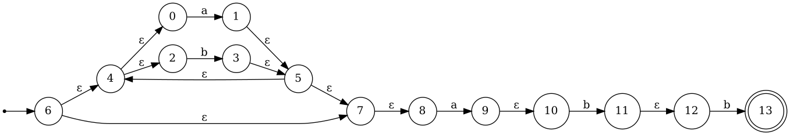

# Partie 5 — Export Graphviz et simulation

## 1. Format de l'automate utilisé

La partie 3 construit l'automate sous forme d'un objet `Fragment`. Il contient :

- `init` : le numéro de l'état initial ;
- `fin` : le numéro de l'état d'acceptation ;
- `transitions` : une liste de triplets `(source, etiquette, cible)`.

Une étiquette contenant un caractère représente une transition normale. La
valeur `None` représente une transition ε. Les deux fonctions de cette partie
reçoivent directement ce fragment : elles ne reconstruisent donc pas
l'automate et n'ont pas besoin de connaître l'arbre syntaxique.

## 2. Export au format Graphviz

Le module `graphviz_export.py` contient trois fonctions :

- `vers_dot(fragment)` construit le contenu du fichier DOT ;
- `ecrire_dot(fragment, chemin)` écrit ce contenu dans le fichier demandé ;
- `rendre_png(chemin_dot, chemin_png)` appelle Graphviz pour produire une image.

L'exporteur crée un graphe orienté de gauche à droite. L'état initial est relié
à un petit point d'entrée, l'état final est dessiné avec un double cercle et
les transitions ε portent l'étiquette `ε`. Avant l'écriture, les transitions
qui ont la même source et la même destination sont regroupées sur une seule
arête. Par exemple, les étiquettes `a` et `b` deviennent `a,b`.

Cette étape ne dépend pas de Graphviz pour générer le fichier `.dot` : Graphviz
est uniquement nécessaire pour transformer ce fichier en image PNG.

Pour l'expression `(a|b)*abb`, l'export produit l'automate suivant. Les deux
branches de l'union sont placées sous l'étoile, puis reliées à la concaténation
finale `abb`.



## 3. Simulation de l'automate

La simulation est réalisée dans `simulation.py`, avec la classe `Simulateur`.
Les transitions sont préparées une seule fois dans deux dictionnaires : les
transitions ε et les transitions classées par caractère. Cela évite de
parcourir toute la liste des transitions à chaque étape.

### 3.1. Calcul de la ε-fermeture

La méthode `epsilon_fermeture(etats)` reçoit un ensemble d'états. Elle utilise
une pile pour parcourir les transitions ε. Un ensemble `fermeture` mémorise les
états déjà visités : un état n'est ajouté à la pile qu'une seule fois. Ainsi,
le parcours se termine même si l'automate contient un cycle ε, comme cela peut
arriver avec `(a*)*`.

### 3.2. Lecture d'un mot

Pour reconnaître un mot `w`, les étapes sont les suivantes :

1. Initialiser l'ensemble courant avec la ε-fermeture de l'état initial.
2. Pour chaque caractère `c` de `w`, suivre toutes les transitions étiquetées
   `c` depuis les états courants.
3. Calculer la ε-fermeture des états atteints et utiliser le résultat comme
   nouvel ensemble courant.
4. À la fin du mot, accepter si l'état final appartient à l'ensemble courant.

Le mot vide est traité naturellement : aucune transition de caractère n'est
parcourue et l'acceptation dépend de la présence de l'état final dans la
fermeture initiale.

La préparation des dictionnaires coûte `O(E)`, où `E` est le nombre de
transitions. Pour un mot de longueur `m`, chaque étape parcourt les états
actifs et les transitions qui en partent, puis calcule une fermeture ε. La
borne générale est `O(m (V + E))`, où `V` est le nombre d'états. La mémoire
utilisée est `O(V + E)`.

## 4. Utilisation en ligne de commande

Depuis la racine du projet :

```bash
python3 src/programme.py "(a|b)*abb" abb aabb ab
```

Résultat :

```text
abb : OUI
aabb : OUI
ab : NON
```

Pour exporter l'automate dans un fichier DOT :

```bash
python3 src/programme.py "(a|b)*abb" abb aabb ab --dot automates/abb.dot
```

Pour produire ensuite l'image PNG :

```bash
dot -Tpng automates/abb.dot -o automates/abb.png
```

Le mot vide est transmis comme argument vide entre guillemets :

```bash
python3 src/programme.py "a?b" "" b ab
```

## 5. Vérifications effectuées

Le fichier `tests/test_etudiant3.py` vérifie notamment :

- les cas de reconnaissance du sujet, dont `@`, `a?b`, `(a*)*` et
  `(a|b)*abb` ;
- les cycles ε, afin de vérifier que la fermeture ne boucle pas indéfiniment ;
- les postfixes enchaînés ;
- le cas `(ab+)?`, qui vérifie qu'un `+` conserve correctement le début du
  facteur lorsqu'il est placé à l'intérieur d'un `?` ;
- la présence de l'état initial, de l'état final et des étiquettes ε dans le
  fichier DOT ;
- le regroupement des transitions parallèles.

Les tests ciblés se lancent avec :

```bash
python3 -m unittest discover -s tests -p "test_etudiant3.py" -v
```

Le jeu de tests de l'équipe et le contrôle automatique des états se lancent
avec :

```bash
python3 tests/run_tests.py
```

Sur le projet fourni, après le correctif de construction des opérateurs `+` et
`?` décrit dans la partie 3, les vérifications ont donné 28/28 tests du fichier
et 506/506 expressions conformes au contrôle de la propriété `2n` (500
expressions générées et 6 cas extrêmes).


## 6. Ressource d'assistance utilisée

Un assistant IA (ChatGPT) a été consulté pour clarifier la méthode de simulation,
proposer une organisation des fonctions et aider à préparer des cas de test.
Le code livré a ensuite été exécuté avec le jeu de tests du projet et les
résultats ont été vérifiés. Cette aide est déclarée conformément aux consignes
du devoir.
